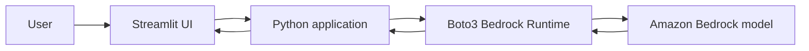

# GenAI Knowledge Assistant — Amazon Bedrock + Streamlit

An **AWS Solutions Architect portfolio prototype**: a Streamlit chat interface that invokes an Amazon Bedrock foundation model via the Bedrock Converse API and Boto3.

> **Status:** Source code and local tests are provided. A real AWS deployment / model invocation must be performed before claiming an operational Bedrock integration. This project is not yet evidence of a successful cloud deployment.

## Architecture

## Features
- Configure AWS Region and model ID using environment variables.
- Ask questions through a simple chat interface.
- Invoke Bedrock using `converse` (not hard-coded answers).
- Show clear error messages when AWS permissions, credentials, or model access are missing.
- Limit response length and keep medical guidance informational only.

## Setup
1. Install Python 3.10+ and the AWS CLI.
2. Configure an AWS profile with permission for `bedrock:InvokeModel` on the selected model. Use SSO or short-lived credentials, **never commit keys**.
3. Create a virtual environment, then run `pip install -r requirements.txt`.
4. Copy `.env.example` to `.env`, choose an available Bedrock model and region.
5. Run `streamlit run app.py`.
6. Ask a non-sensitive question and save a screenshot of the response; also verify the request in AWS logs/usage if available.

Sample questions: "Explain the difference between S3 and DynamoDB" or "Summarize the main purpose of WIC in simple terms."

## Test
Run `python -m unittest discover -s tests -v`. Unit tests mock AWS calls; passing them does **not** confirm Bedrock works in your account.

## Architecture decisions
- **Bedrock instead of self-hosted inference:** managed model access, no GPU hosting; trade-offs include per-token costs, model availability, and regional access.
- **Streamlit:** rapid prototype, easy demo; not a production-grade authentication layer.
- **IAM:** scope model invocation to approved resources. In production, add identity, quotas, logs, and abuse controls.
- **Privacy:** do not submit real patient data, personal information, or secrets.

## Deployment verification (to complete)
- [ ] Confirm Amazon Bedrock model availability in AWS account
- [ ] Verify IAM permissions and billing safeguards
- [ ] Run a successful real model invocation
- [ ] Add a redacted screenshot to `docs/` (no identifying information)
- [ ] Record observed latency and region/model choice

## Attribution
Cloud extension prepared as an independent portfolio exercise. Document actual collaborators and personal contributions before referencing it on a résumé.
