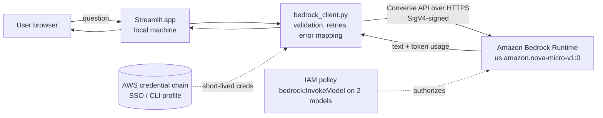

# GenAI Knowledge Assistant — Amazon Bedrock + Streamlit

A Streamlit chat app that calls an Amazon Bedrock foundation model through the **Converse API** using **Boto3**. Built as an AWS Solutions Architect portfolio project.

> **Status:** Code and unit tests are complete. A real Bedrock invocation has **not yet been recorded** in this repository. The "Verified results" section below is filled in only from `docs/evidence/bedrock_check.json` produced by an actual run.

## Architecture



**Request flow:** the user types a question → the app validates it (non-empty, ≤ 4,000 characters) → `BedrockAssistant.ask()` sends the system prompt, the last few conversation turns, and inference settings to `converse` → Bedrock returns text plus token usage and latency → the app displays the answer with a small metrics caption.

## What the code does

| Concern | Implementation |
|---|---|
| Model selection | Sidebar picker (Nova Micro default, Nova Lite) or any ID via `BEDROCK_MODEL_ID` |
| Inference parameters | Max tokens (50–1000) and temperature sliders; validated in `InferenceSettings` |
| Credentials | Never entered in the app. Boto3 uses your AWS SSO/CLI profile (`AWS_PROFILE`) |
| Error handling | AWS error codes (AccessDenied, Throttling, ValidationException, expired token, etc.) mapped to plain-English messages; no stack traces or account details shown in the UI |
| Resilience | Botocore standard retry mode (3 attempts), 5 s connect / 60 s read timeouts |
| Conversation memory | Last 6 exchanges sent as context; failed exchanges are excluded so the API's alternating-role rule is never broken |
| Cost guardrails | Prompt length cap, response token cap, low-cost default model |

## Setup (Windows, PowerShell)

1. Install Python 3.10+ and the [AWS CLI v2](https://docs.aws.amazon.com/cli/latest/userguide/getting-started-install.html).
2. Sign in with short-lived credentials (recommended): `aws configure sso`, then `aws sso login --profile <your-profile>`. Do **not** create long-lived access keys for your root user.
3. Attach the policy in [`docs/iam-policy.json`](docs/iam-policy.json) to your IAM Identity Center permission set (or IAM user).
4. Install dependencies:
   ```powershell
   python -m venv .venv
   .venv\Scripts\Activate.ps1
   pip install -r requirements.txt
   ```
5. Run the tests: `python -m unittest discover -s tests -v`
6. Verify your account and make one real call (costs a fraction of a cent):
   ```powershell
   $env:AWS_PROFILE="<your-profile>"
   python scripts/check_bedrock.py --region us-east-1
   ```
   This prints a masked account ID, lists Nova models in the region, invokes the model once, and saves `docs/evidence/bedrock_check.json`.
7. Start the app: `streamlit run app.py`

Sample questions: "Explain the difference between S3 and DynamoDB" or "Summarize the purpose of WIC in simple terms."

## Testing

`tests/test_bedrock_client.py` has 13 unit tests that use a mocked Bedrock client: request shape, inference settings, input validation, five error paths (access denied, unknown code, missing credentials, network failure, empty response), and conversation-history rules. These tests prove the code's logic, **not** that your AWS account works — that is what `scripts/check_bedrock.py` is for.

## Design decisions and trade-offs

**Model selection — Amazon Nova Micro.** Text-only, among the lowest per-token prices on Bedrock, fast, and available without a separate use-case form. Trade-off: weaker reasoning than larger models (e.g. Claude or Nova Pro). For short educational answers this is the right cost/quality point; the picker makes upgrading a one-click change. It's called through the `us.` cross-region **inference profile**, which routes to whichever US region has capacity — better availability, but requests may be processed in another US region (a data-residency consideration for regulated workloads).

**Security.**
- No secrets in code or config; credentials come from the SDK's credential chain, ideally IAM Identity Center (SSO) with expiring sessions.
- Least-privilege IAM: invoke permission on two specific models only, plus read-only listing for the check script.
- The UI shows sanitized error messages; detailed codes go to the terminal log.
- The system prompt discourages collecting personal data, but this is guidance to the model, **not** a security control. Production would add Amazon Bedrock Guardrails (PII filters), authentication in front of the app, and CloudTrail/CloudWatch monitoring.
- Not suitable for real patient data (no HIPAA controls, no auth, no audit trail).

**Cost.** Pay-per-token with no idle cost. The main levers are the model choice, `maxTokens`, and the conversation-history window (every resent turn costs input tokens). Set an AWS Budget alert before experimenting. No metric in this README is estimated — usage numbers come only from real runs.

**Scalability.** Bedrock is serverless, so the model side scales without servers; the limits are per-account quotas (requests and tokens per minute), which is why throttling is handled explicitly. Streamlit running on a laptop is the bottleneck: it's single-instance and has no login. A production version would run the app on AWS App Runner or ECS Fargate behind Amazon Cognito authentication, add Bedrock Knowledge Bases for retrieval over approved documents (true "knowledge assistant" behaviour), and store chat history in DynamoDB.

## Verified results

_Pending — no real invocation recorded yet._ After running `scripts/check_bedrock.py`, this section should list the date, region, model ID, latency, and token counts copied from `docs/evidence/bedrock_check.json`, plus a screenshot at `docs/screenshots/streamlit-response.png` (crop out account IDs and profile names).

## Attribution

Starter code was generated with ChatGPT and committed by Torhira Aminu; it was then reviewed, refactored, tested, and documented with Claude's assistance. All AWS verification is performed in the author's own account.
